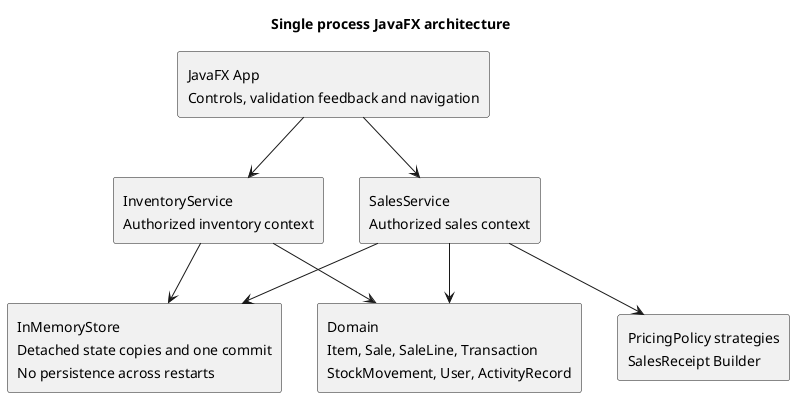

# PearlMart
### Inventory & Sales Management

**CMPS310 · Software Engineering · Fall 2026 · Team 3 / B52**

A JavaFX desktop prototype for registering products, maintaining shared inventory and processing sales. This repository brings together the Milestone 1 analysis and the Milestone 2 implementation, design references, reports and test evidence.

[Report PDF](Milestone-2/report/PearlMart_M2_Consolidated_Report.pdf) · [Report Word](Milestone-2/report/PearlMart_M2_Consolidated_Report.docx) · [Application source](Milestone-2/app) · [Windows evidence](Milestone-2/evidence/windows) · [Scrum board](https://github.com/users/buthaiinah/projects/2)

.png>)

*Shared inventory and new-product registration: P004, Test Notebook, price 5.00 and quantity 4.*

## Contents

- [Project milestones](#project-milestones)
- [Implemented workflows](#implemented-workflows)
- [Windows screenshot gallery](#windows-screenshot-gallery)
- [Run locally](#run-locally)
- [Architecture and design](#architecture-and-design)
- [Testing and evidence](#testing-and-evidence)
- [Repository guide](#repository-guide)
- [Team and collaboration](#team-and-collaboration)
- [Scope and submission status](#scope-and-submission-status)

## Project milestones

| Milestone | Focus | Materials |
| --- | --- | --- |
| **M1 — Analysis and design** | Requirements, DFDs, use cases, class design and Scrum | [Milestone 1 folder](Milestone-1) |
| **M2 — Working prototype** | Add Goods and Process Sale, validation, transaction consistency, design patterns and testing | [Milestone 2 folder](Milestone-2) |
| **M2 — Consolidated report** | Design explanations, constraints, three NFRs, test results and screenshots | [PDF](Milestone-2/report/PearlMart_M2_Consolidated_Report.pdf) / [DOCX](Milestone-2/report/PearlMart_M2_Consolidated_Report.docx) |

M2 was integrated into `main` through [PR #27](https://github.com/buthaiinah/team-3-b52/pull/27). Integration status is separate from completion of every assessed deliverable.

## Implemented workflows

| Capability | Behavior |
| --- | --- |
| **Add Goods — UC04** | Register a product or increase existing stock using an item ID or barcode. |
| **Shared inventory** | Browse and filter products by ID, barcode or name; both workflows use the same store. |
| **Process Sale — UC13** | Start a pending sale, add/remove lines and calculate the payable amount. |
| **Availability — UC14** | Reject requests that exceed available stock and recheck stock at confirmation. |
| **Pricing — UC15–UC16** | Calculate subtotal, discount, tax and total using the configured pricing policy. |
| **Cancellation — UC17** | Cancel a pending sale without deducting stock or issuing a completed receipt. |
| **Transaction history** | Record sales, inventory movements and activity records for the application session. |

## Windows screenshot gallery

These are actual Windows captures stored in the repository. Expand each case to view the evidence at full width.

<details open>
<summary><strong>Completed sale and generated receipt</strong></summary>

.png>)

P001 × 3 at 12.50 plus P002 × 1 at 24.00 gives **61.50**. The sale is **COMPLETED**, a receipt is displayed and the default discount and tax are zero.

</details>

<details>
<summary><strong>Inventory after the completed sale</strong></summary>

.png>)

P001 decreases from **25 to 22**, and P002 from **10 to 9**.

</details>

<details>
<summary><strong>Cancelled sale and unchanged inventory</strong></summary>

.png>)

The sale is **CANCELLED**, with no payable amount and no completed receipt.

.png>)

P001 remains **22** and P002 remains **9** after cancellation.

</details>

<details>
<summary><strong>Validation: zero quantity</strong></summary>

.png>)

A stock addition of **0** is rejected with a positive-whole-number message; P001 remains at 22.

</details>

<details>
<summary><strong>Validation: insufficient stock</strong></summary>

.png>)

A request for **999 units** is rejected when only **22** are available. The sale table remains empty.

</details>

## Run locally

### Prerequisites

- Windows 11 for the demonstrated desktop environment.
- **JDK 21** as the documented project baseline; the supplied Windows test report records JDK 22.0.1.
- **Maven 3.9.x**, available on PATH.
- Internet access for the first Maven dependency download.

Check the installed tools:

```powershell
java -version
javac -version
mvn -version
```

From the repository root:

```powershell
cd Milestone-2/app
mvn clean test
mvn javafx:run
```

Maven supplies JavaFX dependencies; a separate JavaFX SDK is not required for this workflow. The project targets Java 21 and declares JavaFX 21.0.2 and JUnit 5.11.4 in [pom.xml](Milestone-2/app/pom.xml).

### Sample walkthrough

1. P001 starts at 20 units. Add 5 units to obtain 25.
2. Start a sale; add P001 quantity 3 and P002 quantity 1.
3. Confirm the sale: the default total is 61.50, with remaining stock 22 and 9.
4. Start another sale for P001 quantity 2, then cancel it. Stock remains unchanged.
5. Try quantity 0 for a stock addition or quantity 999 for a sale to observe validation.

**Session storage:** data is held in memory. Restarting the application reloads the sample products and clears session transactions.

### Pricing configuration

[pricing.properties](Milestone-2/app/pricing.properties) selects the pricing policy at startup. The default `mode=none` applies no discount or tax. The percentage policy accepts configured discount and tax rates; restart after editing the configuration. Rates are demonstration settings.

## Architecture and design



The JavaFX interface delegates to inventory and sales services. Both services share an in-memory store; domain objects enforce business rules. Candidate transaction state is published only after the operation succeeds.

| Design reference | Link |
| --- | --- |
| Add Goods sequence | [UC04 diagram](Milestone-2/design/UC04_AddGoods.png) |
| Process Sale sequence | [UC13 diagram](Milestone-2/design/UC13_ProcessSale.png) |
| Focused class model | [Class diagram](Milestone-2/design/Focused_Class_Model.png) |
| Strategy and Builder | [Pattern diagram](Milestone-2/design/Patterns.png) |
| Continuity with M1 | [Alignment notes](Milestone-2/M1_ALIGNMENT.md) |

**Strategy** separates pricing policies. **Builder** assembles the completed sales receipt. The PNG and PlantUML files are design references; they do not replace the required native Visual Paradigm project.

## Testing and evidence

The supplied Windows Surefire report records **34 tests, 0 failures, 0 errors and 0 skipped**. This is recorded execution evidence, not a live CI badge or a new test run triggered by this README.

| Evidence | Location |
| --- | --- |
| Windows test summary | [Surefire TXT](Milestone-2/evidence/windows/edu.pearlmart.WorkflowTest.txt) |
| Windows test details | [Surefire XML](Milestone-2/evidence/windows/TEST-edu.pearlmart.WorkflowTest.xml) |
| Functional case catalogue | [Test cases CSV](Milestone-2/evidence/test_cases.csv) |
| Automated workflow tests | [WorkflowTest.java](Milestone-2/app/src/test/java/edu/pearlmart/WorkflowTest.java) |
| Windows GUI captures | [Screenshot folder](Milestone-2/evidence/windows) |
| Earlier prototype captures | [Reference screenshots](Milestone-2/evidence/screenshots) |
| Windows evidence integration | [PR #36](https://github.com/buthaiinah/team-3-b52/pull/36) |

Coverage includes registration, existing-stock additions, invalid input, sale completion, cancellation, receipt generation and transaction-failure behavior. The report separates automated assertions from GUI observations.

## Repository guide

| Path | Purpose |
| --- | --- |
| [Milestone-1/](Milestone-1) | Original requirements, design, report and Scrum material |
| [Milestone-2/app/](Milestone-2/app) | Maven application, resources and tests |
| [Milestone-2/design/](Milestone-2/design) | Architecture, sequence, class and pattern references |
| [Milestone-2/evidence/](Milestone-2/evidence) | Test records and screenshot evidence |
| [Milestone-2/report/](Milestone-2/report) | Consolidated report in Word and PDF |
| [Milestone-2/scrum/](Milestone-2/scrum) | Backlog, sprint planning and meeting templates |

## Team and collaboration

| Team member | Student ID | Scrum role |
| --- | --- | --- |
| Aljazi Alnoaimi | 202004322 | Product Owner / Developer |
| Dhuha Almalki | 202402767 | Scrum Master / Developer |
| Buthaina Albaye | 202109373 | Developer |
| Aldana Al-Mamari | 202304572 | Developer |

Tasks follow **Todo → In Progress → In Review → Done**. Individual contributions and reviews are recorded through repository activity.

[Issues](https://github.com/buthaiinah/team-3-b52/issues) · [Project board](https://github.com/users/buthaiinah/projects/2) · [Milestones](https://github.com/buthaiinah/team-3-b52/milestones) · [Pull requests](https://github.com/buthaiinah/team-3-b52/pulls)

## Scope and submission status

This is a focused academic desktop prototype. Authorized workflow roles are assumed; full login, dashboards, charts, supplier management and database deployment are outside the implemented M2 scope. It does not claim production-scale concurrency or durable storage.

The merged repository contains the application, report and Windows evidence. Final submission checks still include the native M2 `.vpp`, genuine completed Scrum meeting records, exact tested revision provenance and final document review. Issue closure alone is not proof of these artifacts.

The consolidated report was prepared before PR #27 was merged, so its statements that the PR is open are historical and need a post-merge revision. Some supporting M2 notes also retain earlier preparation-stage wording. Use the linked execution evidence for recorded Windows results.

